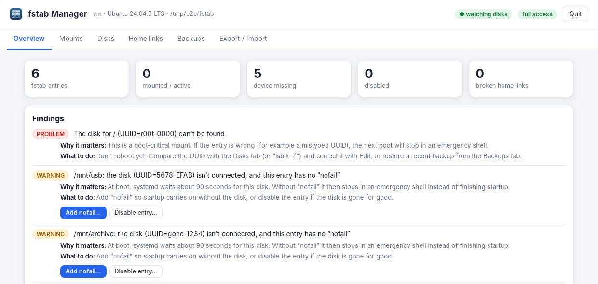
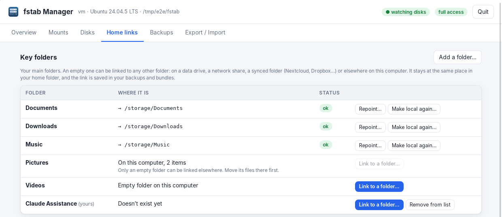

# fstab Manager

fstab Manager keeps your disks mounted where they belong, fixes fstab problems before they stop your computer booting, and brings your setup back after a reinstall. Every change is shown as a preview first and backed up before it's written.

| Part | What it is | Written in |
|---|---|---|
| **fstab Manager** (`fstab-manager`) | Desktop app in its own window, with live detection of plugged-in drives | Go + Wails (WebKitGTK) |
| **fstabctl** | Command-line tool (does everything the app does, plus an interactive wizard) | Python 3.8+, standard library only |

Both read and write the **same files** (backups, snapshots, export bundles), so you can mix them freely.

## Install

**Debian, Ubuntu, Pop!_OS, Linux Mint and derivatives** (built and tested on Ubuntu 24.04; the package also allows Ubuntu 22.04, untested)

```sh
sudo apt install ./fstab-manager_0.6.6-1_amd64.deb ./fstabctl_0.6.1-2_all.deb
```

**Fedora, RHEL and derivatives, openSUSE**

```sh
sudo dnf install ./fstab-manager-0.6.6-1.x86_64.rpm ./fstabctl-0.6.1-2.noarch.rpm
```

The two packages are independent: install either or both. The desktop app needs GTK 3 and WebKitGTK 4.1, which the
package manager installs if they're missing (most desktops already have them). The CLI needs Python 3.8 or newer.
Upgrading from the earlier `fstabctl-gui` package replaces it automatically; the `fstabctl-gui` command still works.

The packages are built for x86-64. For ARM, build them on an ARM machine with `make packages` (see
[docs/DEVELOPMENT.md](docs/DEVELOPMENT.md)).

**Without a package manager**: copy the programs into your `PATH`:

```sh
install -m755 fstab-manager-linux-amd64 ~/.local/bin/fstab-manager
install -m755 fstabctl ~/.local/bin/fstabctl
```

Checksums for every release file are in `SHA256SUMS`.

## First launch

Open **fstab Manager** from your application menu. A splash screen shows the version and author, then closes by itself after 15 seconds; click **×** or press Esc to close it sooner. You can see it again any time with the blue **?** in the bottom-left corner.

Run the app as your normal user. When a change needs administrator rights, your desktop asks for your password.

## The window at a glance

The header shows your computer's name, its system and the fstab file in use, plus two status chips:

- **● watching disks**: drive detection is running, so plugged-in drives are noticed.
- **changes ask for your password**: how changes get administrator rights. If it says **read-only**, see *If something goes wrong*.

Six tabs sit under the header:

| Tab | Use it to |
| --- | --- |
| Overview | See counts, findings with one-click fixes, and disks not yet in fstab |
| Mounts | Add, edit, mount, disable or remove fstab entries |
| Disks | See every disk and partition: size, filesystem, label, UUID, where it's mounted |
| Home links | Link your key folders elsewhere, manage links, discover links |
| Backups | Compare and restore earlier versions of fstab and of your links |
| Export / Import | Save a report or bundle, and import a bundle on a new install |

The footer at the bottom shows the version. The blue **?** next to it opens About. **Quit**, at the top right, closes the app.



## Overview and findings

Findings list anything in your fstab that could cause trouble, most serious first. Each finding says what's wrong, **why it matters** and **what to do**, and most have buttons that fix it.

Every fix button opens a preview showing the exact change. Nothing happens until you click **Apply**. If fstab changed since the page loaded (for example, you edited it in a terminal), the fix is refused instead of changing the wrong line; look again and use the new button.

| Finding | Level | Fix buttons |
| --- | --- | --- |
| A line can't be read | Problem | Add default options, Comment out line |
| Two entries mount at the same folder | Problem | Disable either one |
| The disk for `/`, `/boot` or EFI can't be found | Problem | None: check the UUID before rebooting |
| Disk not connected and no “nofail” | Warning | Add nofail, Disable entry |
| Network share without “\_netdev” | Warning | Add \_netdev |
| In fstab but not mounted right now | Note | Mount now |
| Local disk without “nofail” | Note | Add nofail |
| Uses “discard” | Note | Remove discard |
| Refers to a disk as `/dev/sdb1` | Note | Switch to UUID |

**nofail** is the most important option to understand. Without it, a disk that's missing at boot makes your computer wait about 90 seconds and then stop at an emergency screen. With it, startup carries on without that disk.

Below the findings, the Overview lists formatted disks that aren't in fstab yet, each with **Add to fstab…**, and quick actions: back up now, mount all drives, save the report or bundle.

## Mounts

The Mounts tab lists every fstab entry with its status: **mounted**, **not mounted**, **device missing** or **disabled**. Hover over an option such as `noatime` to see what it does.

**To add a disk:**

1. Click **Add mount…**, or **Add to fstab…** next to a disk on the Overview or Disks tab.
2. Pick the device. For a network share, choose *Network share / other…* and enter `server:/path` (NFS) or `//server/share` (SMB).
3. Check the mount point (the folder where the disk will appear). It's suggested from the disk's label and created for you.
4. Leave **Preset** on *Auto*, or pick one. The note under it shows the preset Auto will use and its exact options.
5. Click **Preview…**, read the change, then **Apply**.
6. Click **Mount now** on the new row to use the disk straight away, without rebooting.

| Preset | Use it for |
| --- | --- |
| data | An ordinary internal disk |
| ssd | SSD or NVMe drives (fewer writes) |
| usb | Removable drives: mounted when you open the folder, never blocks startup |
| windows | NTFS, exFAT and FAT drives, with files owned by you |
| nfs | NFS network shares |
| cifs | SMB/Windows network shares (uses `/etc/samba/credentials`) |

All presets include `nofail`, so a missing disk never stops startup.

**On each row:**

- **Mount now** appears when an entry isn't mounted. **Mount all now…** at the top does every such entry, skipping disks that aren't connected.
- **Edit** changes options, filesystem type or check order, with quick toggles for common options.
- **Disable** keeps the line but tells the system to ignore it. **Enable** brings it back.
- **Remove** deletes the line. The automatic backup keeps it recoverable.

`/`, `/boot` and the EFI partition can't be disabled or removed here, which protects you from an unbootable system.

If Mount now fails, the dialog shows the system's own message, and the reason appears in a red note.

## Plugging in a drive

While the app is open, plugging in a drive shows a notice at the top right within a few seconds. If `notify-send` is installed, you also get a desktop notification.

| Notice | What to do |
| --- | --- |
| New disk detected | Click **Add to fstab…** to give it a permanent place. The dialog opens with the drive already chosen |
| Known disk reconnected | Nothing: it's already in fstab |
| New disk without a filesystem | Format it first (for example with GNOME Disks); it's announced again afterwards |
| Disk removed | Nothing, unless it was in use; the notice says if it's still listed in fstab |

fstab Manager doesn't format or partition drives.

## Home links

Home links let a folder in your home stay where apps expect it, such as `~/Music`, while its files live somewhere else, such as `/storage/Music` or a data drive. The page has three parts.

### Key folders

Documents, Downloads, Music, Pictures and Videos are listed under the names your desktop uses, plus any folders you add with **Add a folder…** (for example *Claude Assistance*). Each row shows where the folder is now:

| It says | What you can do |
| --- | --- |
| Empty folder on this computer, or Doesn't exist yet | **Link to a folder…** |
| On this computer, N items | Move its files first; only an empty folder can be linked elsewhere, so nothing is ever lost |
| → /storage/Music | **Repoint…** to change it, or **Make local again…** to go back to a local folder (your files stay where they are) |



**To link a key folder:**

1. Click **Link to a folder…** on its row.
2. Type the folder, or click **Browse…** to pick it. Any folder works: a data drive, `/storage`, a network share, or a synced folder such as Nextcloud.
3. Leave *Create it if it doesn't exist* ticked if the folder isn't there yet.
4. Click **Preview…**, then **Apply**.

If your other key folders already link into one place, the dialog suggests the same place (say `/storage/Music`), and Browse opens there. If you pick the top of a whole drive, it suggests a subfolder instead.

### Links in your home folder

This list shows each link with **ok** or **BROKEN**; for broken links it gives the reason, such as a drive that isn't mounted. **New link…** creates any link, with Browse. The **In backups** column shows which links are saved: those directly in your home folder always are, and deeper ones when you keep them.

### Discover links

**Search my home folder** finds links you made anywhere in your home, up to six folders deep. Click **Keep** on the ones you want back after a reinstall. App caches, browser profiles and other drives are skipped; tick *show links made by apps* to see those too.

Key folders and kept links are saved in your backups and bundles.

## Backups

You rarely need to think about backups: fstab Manager saves a copy of `/etc/fstab` just before every change, and a snapshot of your links before every link change.

The Backups tab has two lists:

- **fstab backups.** **Diff** compares a backup with the current file. **Restore…** puts it back. **Back up now** makes one with a note of your choice.
- **Link snapshots.** **Restore…** recreates the links in a snapshot. **Snapshot now** makes one.

Restoring is a change like any other: you see a preview, and the current state is backed up first, so a restore can itself be undone.

## Moving to a new install

A **bundle** is one file holding your fstab entries, a list of your disks, your links, your key folders and kept links. Save one before you reinstall or switch distributions, and import it afterwards.

**Before the reinstall:**

1. Open **Export / Import** and click **Portable bundle (.json)…**. Optionally save a **Report** too, a readable summary for your own reference.
2. Keep the bundle somewhere that survives the reinstall: a data drive such as `/storage`, a USB stick, or cloud storage.

**After the reinstall:**

1. Install fstab Manager and plug in your data drives.
2. Open **Export / Import**, click **Choose bundle…** and pick the bundle.
3. Click **Preview fstab import…** and read the plan:
   - **add**: the disk was found and its entry will be added.
   - **add (re-linked by label)**: the disk was reformatted, so it has a new UUID, but exactly one disk has the same label.
   - **add-disabled**: the disk isn't connected; the entry is kept but disabled. Enable it later.
   - **skip**: a system mount, or that folder is already in the new fstab.
4. Click **Apply**, then **Mount all drives now** on the Overview.
5. Back on **Export / Import**, click **Preview link import…**, then **Apply**. Your links come back, including into empty folders the new install created, such as `~/Documents`. Your key folders list and kept links come back too.

If your username changed, links pointing into your old home folder are adjusted to the new one.

## Command line

`fstabctl` does everything the app does, from a terminal or over SSH. Commands that change `/etc/fstab` or mount drives need `sudo`. Add `-n` to any command to preview without changing anything; run `fstabctl COMMAND --help` for every option.

| Command | What it does |
| --- | --- |
| `fstabctl scan` | Lists disks and which aren't in fstab |
| `fstabctl list` | Lists fstab entries with their status |
| `fstabctl verify` | Reports problems, with line numbers |
| `sudo fstabctl add` | Adds a disk with an interactive wizard |
| `sudo fstabctl add /dev/sdb1 /mnt/data -p ssd` | Adds a disk directly, with a preset |
| `sudo fstabctl set /mnt/data --add-options nofail` | Changes an entry's options |
| `sudo fstabctl disable /mnt/usb` / `enable` | Turns an entry off or back on |
| `sudo fstabctl mount --all` | Mounts everything that should be mounted |
| `sudo fstabctl repair --comment-out 7` | Comments out a broken line |
| `fstabctl backups` / `sudo fstabctl restore latest` | Lists backups / restores the newest |
| `fstabctl report -o report.md` | Saves a readable report |
| `fstabctl export -o bundle.json` | Saves a bundle |
| `sudo fstabctl import bundle.json` | Imports fstab entries from a bundle |
| `fstabctl link folders` | Shows key folders and where each one is |
| `fstabctl link add /storage/Music Music --replace-empty` | Links an empty `~/Music` to `/storage/Music` |
| `fstabctl link discover` / `link track NAME` | Finds links / keeps one in backups |
| `fstabctl link import bundle.json` | Restores links from a bundle |
| `fstabctl gui` | Opens the desktop app |

## If something goes wrong

### The computer won't start after an fstab change

This usually means a disk entry without `nofail` whose disk is missing or wrong. You'll land at an emergency or rescue screen.

1. Log in with your password (or choose the recovery entry in the boot menu).
2. Make the system writable: `mount -o remount,rw /`
3. Restore the last good fstab. In this rescue screen you are root, so name your own backup folder: `FSTABCTL_BACKUP_DIR=/home/<you>/.local/share/fstabctl/backups fstabctl restore latest -y`. Or copy a backup by hand: `cp /home/<you>/.local/share/fstabctl/backups/fstab-<date>.bak /etc/fstab`. Or put a `#` in front of the bad line with `nano /etc/fstab`.
4. Run `systemctl daemon-reload`, then `reboot`.

If you can't log in at all, start from a live USB, mount your system partition, and fix `etc/fstab` on it the same way.

**To prevent it:** keep `nofail` on every non-system disk (the presets do), use **Mount now** right after a change so errors show while everything still works, and clear any **Problem** or **Warning** findings before rebooting.

### Other problems

| Problem | What to do |
| --- | --- |
| The header says **read-only** | The app can't ask for your password. Install polkit (`pkexec`), then reopen the app; or use `sudo fstabctl` |
| No password prompt appears | Your desktop needs a polkit agent running; GNOME, KDE and COSMIC include one |
| The window is blank | Run `WEBKIT_DISABLE_DMABUF_RENDERER=1 fstab-manager` from a terminal. With NVIDIA's driver the app already does this |
| Mount now fails with “wrong fs type” | The filesystem type or an option doesn't suit the disk. Check the Disks tab and fix it with **Edit** |
| Mount now fails with “unknown filesystem type” | Install the driver, for example `exfatprogs`, `ntfs-3g`, `nfs-common` or `cifs-utils` |
| A fix button says fstab has changed | fstab was edited after the page loaded. Switch tabs and back, then use the new button |
| A home link shows BROKEN | Its drive probably isn't mounted: mount it, or use **Repoint…** if the folder moved |
| An NTFS drive is read-only | Windows left it hibernated (“Fast Startup”). Shut Windows down fully, then mount again |

## Where things are stored

| What | Where |
| --- | --- |
| fstab backups | `~/.local/share/fstabctl/backups/fstab-<date-time>.bak`, each with a `.json` holding its note |
| Link snapshots | `~/.local/share/fstabctl/backups/links-<date-time>.json` |
| Reports and bundles | Wherever you save them. The Save dialog opens in your Downloads folder, and bundles are saved readable only by you |
| Key folders and kept links | `~/.config/fstabctl/settings.json` |
| Full documentation | `/usr/share/doc/fstab-manager/`, plus `man fstab-manager` and `man fstabctl` |

The app and `fstabctl` share these files, so you can use either one. Backups always go to your own home folder, even when a change is applied with your password.

To keep backups somewhere that survives a reinstall, add `export FSTABCTL_BACKUP_DIR=/storage/fstab-backups` (or another folder on a data drive) to `~/.profile`, then log out and back in.

## More documentation

| Document | Read it for |
|---|---|
| [docs/USER-GUIDE.md](docs/USER-GUIDE.md) | A detailed tour of the app and the CLI, with more workflows |
| [docs/REFERENCE.md](docs/REFERENCE.md) | Every command, option, environment variable, exit code, finding and file format |
| [docs/SECURITY.md](docs/SECURITY.md) | How privileges work, what the app allows, what is and isn't protected |
| [docs/TROUBLESHOOTING.md](docs/TROUBLESHOOTING.md) | Fixes for common problems, including recovering from a bad fstab |
| [docs/DEVELOPMENT.md](docs/DEVELOPMENT.md) | Architecture, building, testing, packaging |
| [CHANGELOG.md](CHANGELOG.md) | What changed in each version |

Installed packages put these under `/usr/share/doc/fstab-manager/` (or `fstabctl/`), and provide
`man fstab-manager` and `man fstabctl`.

## Status and limits

- Linux only (fstab does not exist in this form elsewhere). The app was exercised on x86-64 Ubuntu 24.04 in a virtual
  display; it has not yet been run on a real desktop session, on ARM, or through a reboot.
- Not managed: `/etc/crypttab` (encrypted drives), LVM/RAID setup, btrfs subvolume creation, formatting or
  partitioning. Existing entries for these are shown and preserved.
- The polkit password dialog and desktop notifications depend on your desktop session and have not been tested
  on every environment. See [docs/TROUBLESHOOTING.md](docs/TROUBLESHOOTING.md).
- Always look at the diff before applying, and keep a rescue plan for boot-critical changes.

## License

MIT, see [LICENSE](LICENSE). Copyright (c) 2026 Cameron Stevens.
fstab Manager is a csTechnologies project: [cstevens.ca](https://cstevens.ca).
